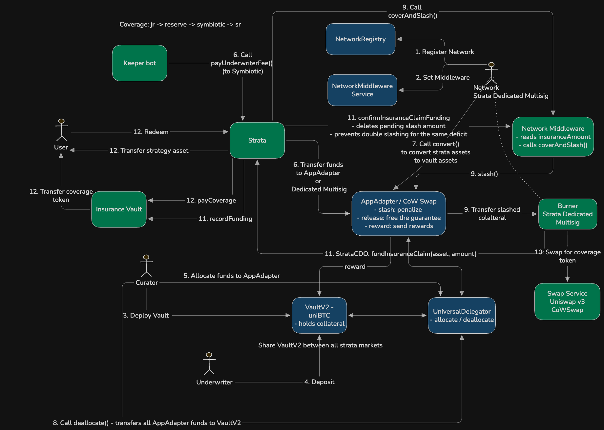

# Strata x Symbiotic Coverage Integration

Symbiotic underwriters post collateral (uniBTC) in a shared VaultV2. Strata pays them an underwriter fee
and, when a Strata market takes a loss that would reach the Senior tranche, slashes that collateral
to make Senior whole. It is a bonded backstop, not co-mingled tranche capital  -  the coverage lives
outside the CDO pool the whole way through: slashed collateral is swapped by the multisig into a
liquid coverage token, parked in the market's `InsuranceVault`, and paid straight to Seniors as they
redeem. It never enters the strategy.

Coverage is **mezzanine**: a loss is absorbed Junior -> reserve -> Symbiotic -> Senior. Symbiotic
only engages for the portion that would otherwise cut into Senior; Junior remains the first-loss
tranche. The same rule applies to a base-asset de-peg: Junior absorbs it first, and Symbiotic covers
only the residual Junior cannot.

One Symbiotic vault + one AppAdapter is shared across all Strata markets; the middleware keeps a
per-market registry keyed by CDO address and nets shared capacity across markets.

## Flow



## Contracts

- **`InsuranceMiddleware`**  -  the only custom contract; also the shared insurance pool
  (`IInsurancePool`). It exposes:
  - `request(cdo, lossAmount)`  -  **view**. Returns how much of a loss the pool can currently cover
    for a market, in that market's base asset. Bounded by the adapter's slashable stake minus
    coverage already committed to every other market (`_committedVault()`), so simultaneous
    multi-market stress cannot over-commit the shared stake. Adds this market's funded surplus and unallocated pending slash proceeds.
    Reserves nothing and slashes nothing.
  - `coverAndSlash(cdo, lossBase)`  -  **the main path**, called by the market's own accounting in the
    same transaction the claim is booked, before storing the claim increase. Reuses funded surplus and unallocated pending proceeds,
    then slashes the buffered vault equivalent of the remainder (capped to live `slashable()`).
    Returns the sum of reused and freshly slashed coverage in base assets.
  - `confirmInsuranceClaimFunding(cdo, amount)`  -  called by the CDO during `fundInsuranceClaim` (or the owner as fallback);
    clears the entire pending slash batch, regardless of the funded value.
  - Registry: `setMarket`. Upgradeable / Ownable2Step / Pausable.
- **`OracleAdapter` / `IOracleAdapter`**  -  prices base assets and the vault asset (uniBTC) in a
  common quote so claims can be sized in vault-asset terms (`_toVaultAsset` / `_toBaseAsset`).
- **`InsuranceVault`**  -  one per CDO. Holds the swapped coverage proceeds (e.g. USDC) and pays a
  redeeming Senior its covered slice. Funded through `StrataCDO.fundInsuranceClaim`, which transfers the
  proceeds in and calls `recordFunding`; funded coverage is tracked by that call rather than by the token
  balance, so a stray transfer cannot pass itself off as backing. `payCoverage` is CDO-only and
  **reverts** when the claim is unfunded rather than short-paying the user. The coverage token is
  chosen per finalization but can only change while the vault is empty.
- **`IAppAdapter` / `IStrataAccounting` / `IInsuranceMiddleware` / `IInsurancePool` /
  `IInsuranceVault`**  -  trimmed local interfaces, so the integration does not modify the core
  `IAccounting`.

The Strata-side hooks live in the accounting/CDO contracts: `Accounting` (and `DiscreteAccounting`,
`DYSAccounting`, `MTMAccounting`) track `underwriterFeeNav`, `insuranceAmount` and `srtInsuranceFundNav`,
and hold `insuranceMiddleware`; `StrataCDO` exposes `payUnderwriterFee`, `fundInsuranceClaim`, and `setInsuranceConfig`.

Coverage is **synchronous**: the accounting slashes in the same transaction it books a claim, from
two places  -  the loss waterfall in `updateAccounting`, and a de-peg in `setValuationPrice`.

## Tranche exit and share-burn fees after a depeg or Junior depletion

Every valuation update below $1, or accounting update that reduces Junior NAV to `ONE_ASSET`
or below, sets `feeJrtRetentionBps` and `feeSrtRetentionBps` to 100%,
alongside disabling performance fees. Exit and share-burn fees remain payable by users, but
stay entirely in their respective tranche; none accrues to reserve. This avoids debiting
factual NAV for a fee priced using effective valuation NAV.

Recovery does not restore the previous retention rates. Only the owner can change them through
`setFeeRetentionBps`. If reserve accrual is explicitly re-enabled during a depeg without an open
claim, Senior fees use the proportional valuation-withdrawal split, including its tracker updates.

While `insuranceAmount > 0`, Senior fees are always fully retained regardless of the configured
retention rate, both at par and during a depeg. This avoids moving insurance backing into reserve.
The depletion trigger also applies at par, but requires a decrease so an empty market does not
disable reserve accrual. Underwriter fees remain separate.

## Underwriter Fee

The fee is charged to **Senior**, the tranche being insured, out of its own realized gain - not out of
the pooled gain alongside the reserve. `underwriterFeeBps` is therefore a share of the risk premium
rather than a share of the gain:

```
underwriterFeePct = riskPremium * underwriterFeeBps / 1e18
underwriterFee_dT = srtGain * underwriterFeePct / 1e18
srtNav            = srtNav + srtGain - underwriterFee_dT
```

The deducted amount accrues to the separate `underwriterFeeNav` bucket. The realized-loss waterfall is
Junior NAV, reserve, Symbiotic coverage, accrued underwriter fees, then Senior NAV. By policy, insurance
is requested for the full remainder after Junior and reserve, including accrued underwriter fees and
protected Junior dust, even when no Senior remains. Fees absorb any loss not covered by insurance
before Senior does. Existing Junior dust protection and `NavBelowMinimum` remain unchanged. Existing
empty-market shortcuts still cap fees to available assets; MTM also uses that shortcut at zero NAV.
Since it is a straight transfer from Senior into that bucket, it cancels out of the NAV identity.
`payUnderwriterFee` sweeps the accrued fee, in the strategy share token, down one of two routes:

- **Automatic:** to the AppAdapter, which `convert()`s it to the vault asset; a `deallocate` then
  pushes it into the Symbiotic vault so underwriter shares appreciate (no shares minted).
- **Manual:** to a dedicated multisig, which deposits it into the Symbiotic vault directly as the
  Strata underlying asset.

Underwriter fee payment is discretionary (Symbiotic gives full flexibility)  -  there is no fixed accrual schedule.

## Senior benchmark coverage policy

In `DYSAccounting` and `MTMAccounting`, Symbiotic coverage can fund accrued Senior benchmark yield,
not only principal losses. Benchmark already recorded in `srtPnLBenchmark` remains a Senior
entitlement if Junior later depletes. At reconciliation, the existing waterfall uses Junior and
reserve first, then requests Symbiotic coverage for the remaining shortfall. Coverage is bounded by
available capacity; any uncovered remainder continues through the waterfall.

New benchmark accrual follows these rules:

- **Projection updates:** available Junior NAV (the lower of real and projected NAV) must be above
  `ONE_ASSET` both before and after the projected allocation.
- **Headroom cap:** new benchmark is capped by starting available Junior NAV above `ONE_ASSET`,
  less earlier benchmark entitlement not already embedded in Senior projection. This prevents
  deferred fee residue from supporting repeated accrual against the same headroom.
- **Reconciliation:** the same cap applies to the final uncheckpointed interval before projection
  is unwound. If a realized loss then depletes Junior, the preserved entitlement may still draw on
  reserve or insurance. Intervals starting at or below the floor accrue no new benchmark.
- **During a depeg:** the cap uses effective Junior headroom and accounts for the valuation
  protection required by new Senior gain. Neither cap cancels benchmark accrued earlier.

Operators may set the benchmark APR to zero before Junior depletes. This stops future accrual;
it does not erase existing benchmark entitlement.

The underwriter fee is calculated on positive allocated Senior gain, including the benchmark uplift,
before the loss waterfall. It is not recalculated solely on the gain that remains after the waterfall.
Underwriters therefore accept that coverage may fund accrued benchmark yield and its associated fee.

## Realized Senior yield during a valuation loss

During a valuation loss, `DYSAccounting` and `MTMAccounting` scale positive realized Senior strategy
gains by `valuationPrice` before applying benchmark entitlement and underwriter fees. The remainder
stays with Junior, helping fund the valuation protection attached to Senior's new gain. Previously
accrued benchmark entitlement retains the treatment described above. Negative realized PnL and
at-par allocations are unchanged.

`Accounting` and `DiscreteAccounting` continue using target-APR gains capped by Junior's effective
protection headroom.

## Loss coverage: the `insuranceAmount` model

All four accounting variants (`Accounting`, `DiscreteAccounting`, `DYSAccounting`, `MTMAccounting`)
share one model. The Symbiotic storage block sits at identical slots (143-147) in all four, so a
proxy can be upgraded between them.
Inside the NAV split, when a loss exceeds Junior + reserve:

1. The full remainder, including any unbacked underwriter fees or protected Junior dust, is offered
   to the pool via `_requestInsurance(loss)` -> `IInsurancePool.request()`. The covered portion is
   subtracted from the loss and booked to `insuranceAmount` (a claim, not tranche capital).
   `updateAccountingInner` secures coverage through `coverAndSlash` before persisting the claim increase.
   Accrued underwriter fees absorb any uncovered loss before Senior does. The existing
   `NavBelowMinimum` check still rejects a loss that reaches protected Junior dust.
2. The identity `navT1 + insuranceAmount == jrt + srt + reserve + underwriter fee` holds on every path and
   guards the split  -  a threading bug reverts with `InvalidNavSplit`.
3. A later **recovery gain first unwinds** the outstanding claim (self-healing) before any gain is
   distributed to tranches, reserve, or underwriter fee.
4. The claim settles **at redemption**, not by injecting into the strategy. The slashed collateral
   is swapped into a liquid coverage token and parked in the `InsuranceVault`: on a loss the
   underlying is usually the impaired asset, so buying back into it would expose Senior to a further
   drop. When a Senior redeems, `updateBalanceFlow` reports the covered slice of that exit
   (`insuranceBaseOut`), clears it from `insuranceAmount`, and the CDO pays it from the vault while
   only the remainder comes out of the strategy. `srtBaseNav` drops by the full outflow but `nav`
   only by the strategy slice  -  both sides of the identity still move together.

The tranche carries no book loss (Senior stays whole from the moment of the loss); the claim simply
tracks the coverage owed until Senior redeems.

Because the claim is booked in the same transaction that slashes but the coverage token only lands
after an off-chain swap, `payCoverage` reverts while a claim is unfunded. The keeper therefore has
to run `updateAccounting` itself, finalize the Symbiotic claim, swap, and fund the vault before
Senior redemptions clear.

### Pending slash proceeds and batch funding

Before funding, released slash proceeds can back another claim for the same market. The middleware values pending collateral at the current oracle price, applies the swap buffer, and reserves enough for the existing claim after funded coverage. Only the excess is reusable. Reallocation does not reduce `pendingInsuranceClaimFunding`: those assets still need to be swapped and funded. Pending proceeds are not liquid vault coverage and cannot pay a redemption until funded.

Every `fundInsuranceClaim` call finalizes the **entire pending batch**. Its confirmation clears `pendingInsuranceClaimFunding`, even when swap losses, fees or price movements make the funded value smaller. This prevents spent buffer or swap losses from appearing as reusable collateral. Operators must account for all batch proceeds before funding; partial-batch reuse is not supported. Any residual collateral outside the vault must be handled manually and is no longer counted as pending after confirmation. Existing insurance claims remain outstanding, and funding shortfalls still require a top-up or the normal write-down procedure.

Before batch finalization, surplus collateral returned manually must be recorded with `confirmSlashedCollateralReturned`, so it cannot be reused. Funded surplus remains withdrawable through `withdrawSurplus`. Neither reuse nor funding resets cumulative `totalSlashed`.

### Funding shortfalls after the collateral swap

Slashing values collateral at slash time and includes the configured `bufferBps` cushion.
If collateral prices fall or swap slippage exceeds that cushion before the proceeds are funded,
the vault can receive less than the outstanding claim. This market risk is borne by the protocol:
the reserve manager is responsible for arranging and funding the shortfall, rather than automatically
reducing Senior entitlements or charging underwriters again for the same claim.

The operator must:

1. Keep Senior withdrawals paused while finalizing the slash, swapping collateral, and funding coverage.
2. Fund the proceeds through `StrataCDO.fundInsuranceClaim` and compare `InsuranceVault.fundedCoverage`
   with the whole current `Accounting.insuranceAmount`, converted using the current valuation price
   and token decimals. Checkpoint accounting before assessing the outstanding claim.
3. Promptly top up any shortfall through `StrataCDO.fundInsuranceClaim`, using the vault's current
   coverage token and an account with `RESERVE_MANAGER_ROLE`. A direct token transfer to the vault
   does not update `fundedCoverage`; funding must be recorded through the CDO.
4. Reopen Senior withdrawals only after recorded funding covers the whole outstanding claim.
   Recheck coverage after further claim or valuation-price changes.

Partial funding is accepted without automatically writing down the claim. `payCoverage` pays each
requested slice in full or reverts; it does not require the whole claim to be funded first. If
withdrawals remain open, early exits can consume available coverage and later exits can revert,
including their strategy-funded portion. Pausing during funding is an operator responsibility,
not an automatic consequence of an underfunded vault.

For example, a claim of 801 backed by 480.6 coverage tokens at par has a 320.4 shortfall. An exit
consuming half the claim receives 400.5, leaving only 80.1 for later exits. Funding the missing
320.4 restores backing for the remaining claim.

If further funding is unavailable, the separate `writeDownInsuranceClaim` procedure below can
recognize an eligible unrecoverable shortfall as a Senior loss. This is an explicit loss-acceptance
decision, not the normal swap-shortfall policy. Perform it before reopening withdrawals so early
exits do not avoid losses subsequently assigned to remaining Seniors. Valuation-only claims are
not eligible for a principal write-down.

## Valuation coverage: the `srtInsuranceFundNav` model

A base-asset de-peg is a different kind of loss. No tokens leave, so `nav` does not move  -  the loss
only appears once value is expressed in the quote currency, which happens on the fly in
`calcEffectiveNav`. Junior absorbs it first (it tops Senior up until Junior hits its dust floor);
Symbiotic covers only the residual Junior cannot absorb.

`setValuationPrice` therefore runs its own coverage step:

1. `_seniorValuationShortfall(price)` sizes what Senior needs to be whole at the new price
   (`srtPrincipal / price`, where `srtPrincipal` excludes de-peg credit already granted), nets off Senior's
   self-fund and Junior's headroom, and returns the residual.
2. That residual goes to `coverAndSlash`. The covered amount is booked to **three** places:
   `srtInsuranceFundNav` (marks the credit as compensation, not principal), `srtBaseNav` (Senior is
   credited the tokens it is owed) and `insuranceAmount` (the claim). Crediting Senior is what keeps
   `nav + insuranceAmount == jrt + srt + reserve + underwriter fee` balanced  -  booking the claim alone would
   revert every `totalAssets()` with `InvalidNavSplit`.
3. The claim settles at redemption from the `InsuranceVault`, exactly as for a strategy loss. The
   credit is resized after DYS/MTM accounting updates as the remaining valuation shortfall changes.
4. On **re-peg**, `_resyncInsuranceFundNav` unwinds the credit: Senior hands it back and the claim is
   cancelled by the same amount, leaving `nav` untouched. Collateral already slashed stays in the
   vault as surplus rather than being credited to a tranche. Later claims reuse funded surplus
   and unallocated pending proceeds before slashing additional collateral. Coverage previews and
   `coverAndSlash` both reserve backing for live claims before reusing either source.
   The vault owner can return surplus through `withdrawSurplus` after checkpointing accounting,
   while retaining enough funded coverage for the recorded live claim.

Because the coverage is credited into `srtBaseNav`, `calcEffectiveNav` stays a pure transfer
(`jrtEffective + srtEffective == jrtFact + srtFact`); it only excludes `srtInsuranceFundNav` when
sizing Senior's need, so compensation is not itself compensated.


### Conservative Senior redemptions with valuation coverage

During a valuation loss with insufficient Junior headroom and an outstanding insurance claim, conservative pricing applies to Senior's non-insurance position: unreconciled projection is excluded from redeemable NAV. The current insurance claim is still allocated pro rata to exiting Seniors, subject to the normal payout cap and vault funding requirements. Coverage booked for existing projection is not separately removed from the exiter's allocation.

This deliberately allows Senior to forfeit projected gain itself while retaining its share of the insurance coverage associated with that gain. Underwriters must account for this exposure: existing projection can enter valuation coverage even though new projection is capped when Junior has no available headroom. Conservative pricing does not restrict the resulting payout to protection of settled principal alone.

For example, 1,000 settled Senior principal plus 99 projection and 1,099 valuation credit gives 2,198 stored Senior NAV. At a valuation price of $0.50, conservative redemption excludes 99, leaving 2,099. A half-holder receives 500 strategy base units ($250) and coverage for 549.5 base units ($274.75), totaling $524.75 rather than $500. This assumes zero fees and funded coverage tokens valued at $1.

Allocation uses the current claim after accounting is checkpointed. Subsequent reconciliation, projection unwind or valuation recovery can release excess credit before redemption; this policy does not preserve a historical claim amount or permanently realize projected gain. It also does not change how pending slash proceeds are handled. See [SIP-09, Section 3.1](../SIPs/SIP-09-conservative-redemption-price.md#31-conservative-senior-redemption-during-insured-valuation-loss).

### Live MTM losses before reconciliation

During a depeg, a live MTM loss may reduce Junior backing already pledged to Senior without immediately adding the corresponding insurance coverage. Senior exits use that lower live value, including with conservative pricing. Additional protection may be recognized at reconciliation for the remaining holders; earlier exiters are not reimbursed. This timing difference is accepted and does not imply that all claim changes wait for reconciliation.

Based on market conditions after a valuation loss, the operator may set the strategy epoch duration to zero. The strategy must then report fresh NAV as both settled and live NAV, so each newly reported change reconciles at the next accounting update. The operator should checkpoint and fund any new claim before reopening redemptions. See [SIP-10, Section 10.1](../SIPs/SIP-10-mtm-projection.md#101-live-losses-during-a-valuation-loss) for the policy and required snapshot semantics.

### Unrecoverable funding shortfall

A realized-loss claim remains denominated in base assets. If it was funded during a depeg,
a partial or full recovery can leave the vault short of coverage tokens. Before reopening withdrawals,
the operator should fund all available slash proceeds and assess whether more funding can be obtained.
The same procedure can apply to an eligible unrecoverable shortfall after a collateral swap, once
the protocol has established that the required top-up cannot be funded.

If the remainder is unrecoverable, an account with `RESERVE_MANAGER_ROLE` can call
`StrataCDO.writeDownInsuranceClaim(maxPrincipalLoss)`. The argument is the maximum accepted permanent
Senior principal loss in base-asset units, not an exact amount to debit. The function:

- Checkpoints accounting and values vault funding at the current valuation price in the same transaction.
- Calculates a principal loss that closes the funding gap, including any valuation-credit unwind.
- Reverts atomically if the required loss exceeds the operator's limit, available settled principal, or realized claim.
- Preserves positive live projection and scales entry self-funding with the remaining principal during a depeg.
- Reduces the claim and Senior NAV equally, including released valuation credit; strategy and Junior NAV stay unchanged.
- Synchronizes middleware backing and adjusts the DYS/MTM floor baseline so it cannot restore the loss.
- Returns the actual principal loss and emits `InsuranceClaimWrittenDown(amount)` when processing a shortfall.
  An already-funded claim returns zero without a write-down. No tokens move in the write-down itself.

To estimate `maxPrincipalLoss`, read `Accounting::insuranceAmount`, `Accounting::valuationPrice`,
and `InsuranceVault::fundedCoverage`. With token amounts expressed in whole-token units and the
valuation price expressed as a decimal (for example, `0.99`):

```text
shortfallBase =
    max(0, Accounting::insuranceAmount - InsuranceVault::fundedCoverage / Accounting::valuationPrice)
```

For raw contract values, normalize token decimals and the price's `1e18` scale. To match the CDO's
integer rounding, calculate:

```text
coverageInBaseDecimals = floor(fundedCoverage * 10^baseDecimals / 10^coverageDecimals)
fundedBase = floor(coverageInBaseDecimals * 1e18 / valuationPrice)
shortfallBase = max(0, insuranceAmount - fundedBase)
```

Use `fundedCoverage`, not the vault's raw token balance. The operator can set `maxPrincipalLoss` to
`shortfallBase` if they accept that much principal loss, passing it in base-asset smallest units.
The calculated loss may be smaller when valuation credit unwinds. The search checks up to 32 raw
base-asset units below its candidates to handle rounding dips. It does not guarantee the absolute
minimum; wider rounding gaps may still require a looser operator limit or cause the call to revert.
Any successful call stays within the operator limit and leaves the remaining claim fully funded.
For a tighter limit, simulate `StrataCDO.writeDownInsuranceClaim` and use its returned principal loss.
The simulation checkpoints accounting; standalone getter values may be stale. The transaction sizes
the loss again and reverts if the required principal loss exceeds the supplied limit.

For example, a 101-base claim backed by 90.9 coverage tokens at par needs a 10.1 principal loss.
A limit of 20 accepts that loss but still debits only 10.1; a limit below 10.1 reverts.
During a depeg at 0.80, a 125-base funding gap may need only 100 of principal loss plus 25 of valuation-credit unwind.
The limit controls the principal loss, not the combined NAV reduction.

Valuation-only claims cannot be cancelled as principal losses. Existing pending slash proceeds are not
cleared by this action, and a later valuation change can create a new funding gap. The operator must
still establish that funding is unrecoverable; automatic sizing does not make that decision.

### Oracle quote chains

`OracleAdapter` registers each asset with its aggregator, decimals, heartbeat and optional `quoteAsset`. A zero quote asset means USD. Otherwise, register the quote asset first; for example, register BTC/USD before uniBTC/BTC. Chains may contain more than two feeds, and each hop checks its own heartbeat. Circular chains are rejected, including when updating an existing feed. Removing a feed also makes dependent price reads revert until it is registered again.
