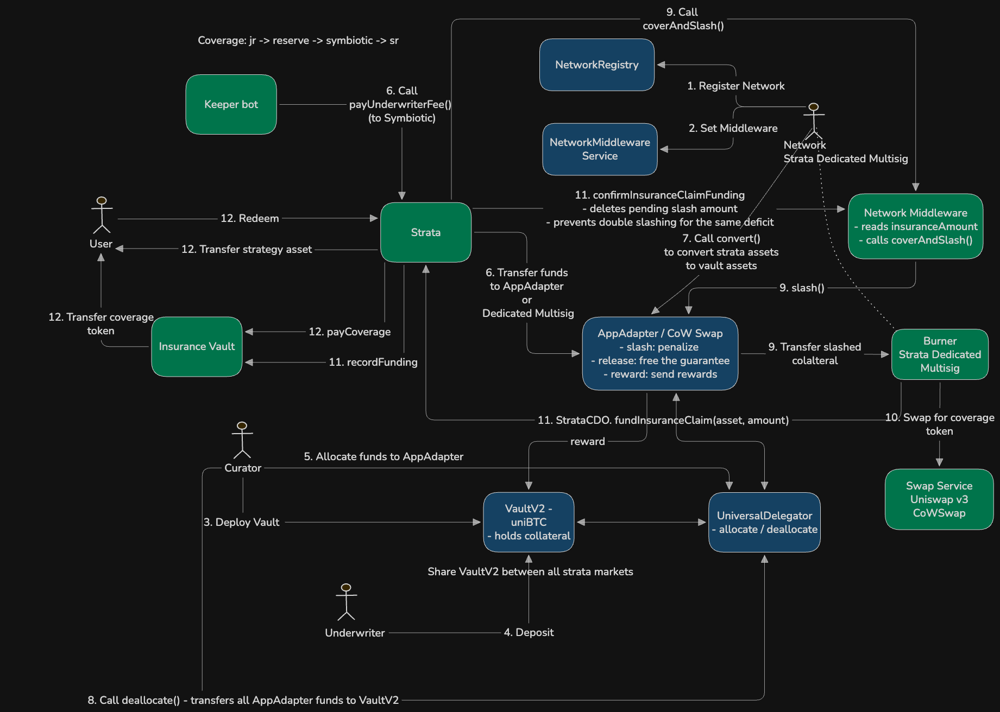

# Strata x Symbiotic Coverage Integration

Symbiotic underwriters post collateral (uniBTC) in a shared VaultV2. Strata pays them an underwriter fee
and, when a Strata market takes a loss that would reach the Senior tranche, slashes that collateral
to make Senior whole. It is a bonded backstop, not co-mingled tranche capital  -  the coverage lives
outside the CDO pool the whole way through: slashed collateral is swapped by the multisig into a
liquid coverage token, parked in the market's `InsuranceVault`, and paid straight to Seniors as they
redeem. It never enters the strategy.

Coverage is **mezzanine**: a loss is absorbed Junior -> reserve -> Symbiotic -> Senior. Symbiotic
only engages for the portion that would otherwise cut into Senior; Junior remains the first-loss
tranche. The same rule applies to a base-asset de-peg: Junior absorbs it first, and Symbiotic covers
only the residual Junior cannot.

One Symbiotic vault + one AppAdapter is shared across all Strata markets; the middleware keeps a
per-market registry keyed by CDO address and nets shared capacity across markets.

## Flow



## Contracts

- **`InsuranceMiddleware`**  -  the only custom contract; also the shared insurance pool
  (`IInsurancePool`). It exposes:
  - `request(cdo, lossAmount)`  -  **view**. Returns how much of a loss the pool can currently cover
    for a market, in that market's base asset. Bounded by the adapter's slashable stake minus
    coverage already committed to every other market (`_committedVault()`), so simultaneous
    multi-market stress cannot over-commit the shared stake. Adds this market's funded surplus.
    Reserves nothing and slashes nothing.
  - `coverAndSlash(cdo, lossBase)`  -  **the main path**, called by the market's own accounting in the
    same transaction the claim is booked, before storing the claim increase. Reuses funded surplus,
    then slashes the buffered vault equivalent of the remainder (capped to live `slashable()`).
    Returns the sum of reused and freshly slashed coverage in base assets.
  - `confirmInsuranceClaimFunding(cdo, amount)`  -  called by the CDO during `fundInsuranceClaim` (or the owner as fallback);
    clears the in-flight amount.
  - Registry: `setMarket`. Upgradeable / Ownable2Step / Pausable.
- **`OracleAdapter` / `IOracleAdapter`**  -  prices base assets and the vault asset (uniBTC) in a
  common quote so claims can be sized in vault-asset terms (`_toVaultAsset` / `_toBaseAsset`).
- **`InsuranceVault`**  -  one per CDO. Holds the swapped coverage proceeds (e.g. USDC) and pays a
  redeeming Senior its covered slice. Funded through `StrataCDO.fundInsuranceClaim`, which transfers the
  proceeds in and calls `recordFunding`; funded coverage is tracked by that call rather than by the token
  balance, so a stray transfer cannot pass itself off as backing. `payCoverage` is CDO-only and
  **reverts** when the claim is unfunded rather than short-paying the user. The coverage token is
  chosen per finalization but can only change while the vault is empty.
- **`IAppAdapter` / `IStrataAccounting` / `IInsuranceMiddleware` / `IInsurancePool` /
  `IInsuranceVault`**  -  trimmed local interfaces, so the integration does not modify the core
  `IAccounting`.

The Strata-side hooks live in the accounting/CDO contracts: `Accounting` (and `DiscreteAccounting`,
`DYSAccounting`, `MTMAccounting`) track `underwriterFeeNav`, `insuranceAmount` and `srtInsuranceFundNav`,
and hold `insuranceMiddleware`; `StrataCDO` exposes `payUnderwriterFee`, `fundInsuranceClaim`, and `setInsuranceConfig`.

Coverage is **synchronous**: the accounting slashes in the same transaction it books a claim, from
two places  -  the loss waterfall in `updateAccounting`, and a de-peg in `setValuationPrice`.

## Underwriter Fee

The fee is charged to **Senior**, the tranche being insured, out of its own realized gain - not out of
the pooled gain alongside the reserve. `underwriterFeeBps` is therefore a share of the risk premium
rather than a share of the gain:

```
underwriterFeePct = riskPremium * underwriterFeeBps / 1e18
underwriterFee_dT = srtGain * underwriterFeePct / 1e18
srtNav            = srtNav + srtGain - underwriterFee_dT
```

The deducted amount accrues to the separate `underwriterFeeNav` bucket, which never absorbs losses.
Since it is a straight transfer from Senior into that bucket, it cancels out of the NAV identity.
`payUnderwriterFee` sweeps the accrued fee, in the strategy share token, down one of two routes:

- **Automatic:** to the AppAdapter, which `convert()`s it to the vault asset; a `deallocate` then
  pushes it into the Symbiotic vault so underwriter shares appreciate (no shares minted).
- **Manual:** to a dedicated multisig, which deposits it into the Symbiotic vault directly as the
  Strata underlying asset.

Underwriter fee payment is discretionary (Symbiotic gives full flexibility)  -  there is no fixed accrual schedule.

## Loss coverage: the `insuranceAmount` model

All four accounting variants (`Accounting`, `DiscreteAccounting`, `DYSAccounting`, `MTMAccounting`)
share one model. The Symbiotic storage block sits at identical slots (143-147) in all four, so a
proxy can be upgraded between them.
Inside the NAV split, when a loss overflows Junior + reserve toward Senior:

1. The Senior-bound remainder is offered to the pool via `_requestInsurance(loss)` ->
   `IInsurancePool.request()`. The covered portion is subtracted from the loss so Senior is **held
   whole**, and booked to `insuranceAmount` (a claim, not tranche capital). `updateAccountingInner`
   secures coverage through `coverAndSlash` before persisting the claim increase. If the pool cannot back it in full, Senior absorbs the remainder.
2. The identity `navT1 + insuranceAmount == jrt + srt + reserve + underwriter fee` holds on every path and
   guards the split  -  a threading bug reverts with `InvalidNavSplit`.
3. A later **recovery gain first unwinds** the outstanding claim (self-healing) before any gain is
   distributed to tranches, reserve, or underwriter fee.
4. The claim settles **at redemption**, not by injecting into the strategy. The slashed collateral
   is swapped into a liquid coverage token and parked in the `InsuranceVault`: on a loss the
   underlying is usually the impaired asset, so buying back into it would expose Senior to a further
   drop. When a Senior redeems, `updateBalanceFlow` reports the covered slice of that exit
   (`insuranceBaseOut`), clears it from `insuranceAmount`, and the CDO pays it from the vault while
   only the remainder comes out of the strategy. `srtBaseNav` drops by the full outflow but `nav`
   only by the strategy slice  -  both sides of the identity still move together.

The tranche carries no book loss (Senior stays whole from the moment of the loss); the claim simply
tracks the coverage owed until Senior redeems.

Because the claim is booked in the same transaction that slashes but the coverage token only lands
after an off-chain swap, `payCoverage` reverts while a claim is unfunded. The keeper therefore has
to run `updateAccounting` itself, finalize the Symbiotic claim, swap, and fund the vault before
Senior redemptions clear.

## Valuation coverage: the `srtInsuranceFundNav` model

A base-asset de-peg is a different kind of loss. No tokens leave, so `nav` does not move  -  the loss
only appears once value is expressed in the quote currency, which happens on the fly in
`calcEffectiveNav`. Junior absorbs it first (it tops Senior up until Junior hits its dust floor);
Symbiotic covers only the residual Junior cannot absorb.

`setValuationPrice` therefore runs its own coverage step:

1. `_seniorValuationShortfall(price)` sizes what Senior needs to be whole at the new price
   (`srtPrincipal / price`, where `srtPrincipal` excludes de-peg credit already granted), nets off Senior's
   self-fund and Junior's headroom, and returns the residual.
2. That residual goes to `coverAndSlash`. The covered amount is booked to **three** places:
   `srtInsuranceFundNav` (marks the credit as compensation, not principal), `srtBaseNav` (Senior is
   credited the tokens it is owed) and `insuranceAmount` (the claim). Crediting Senior is what keeps
   `nav + insuranceAmount == jrt + srt + reserve + underwriter fee` balanced  -  booking the claim alone would
   revert every `totalAssets()` with `InvalidNavSplit`.
3. The claim settles at redemption from the `InsuranceVault`, exactly as for a strategy loss. The
   credit itself persists while the de-peg lasts.
4. On **re-peg**, `_resyncInsuranceFundNav` unwinds the credit: Senior hands it back and the claim is
   cancelled by the same amount, leaving `nav` untouched. Collateral already slashed stays in the
   vault as surplus rather than being credited to a tranche. Later claims reuse funded surplus
   before slashing additional collateral. Both coverage previews and the owner slash path account
   for this funding; proceeds still awaiting funding are not reusable surplus.
   The vault owner can return surplus through `withdrawSurplus` after checkpointing accounting,
   while retaining enough funded coverage for the recorded live claim.

Because the coverage is credited into `srtBaseNav`, `calcEffectiveNav` stays a pure transfer
(`jrtEffective + srtEffective == jrtFact + srtFact`); it only excludes `srtInsuranceFundNav` when
sizing Senior's need, so compensation is not itself compensated.
